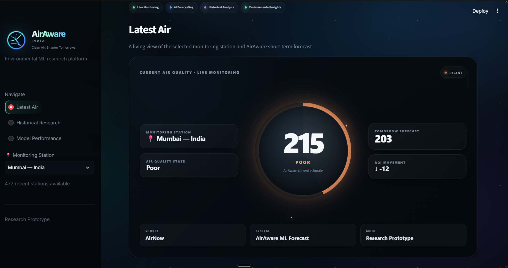
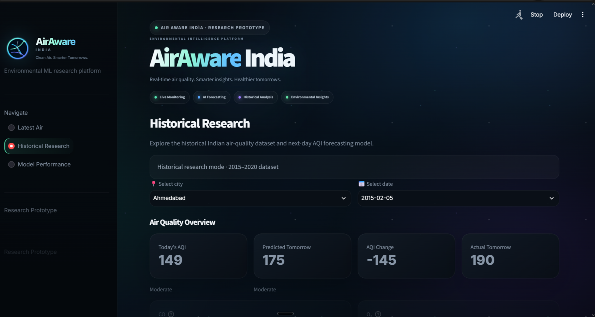
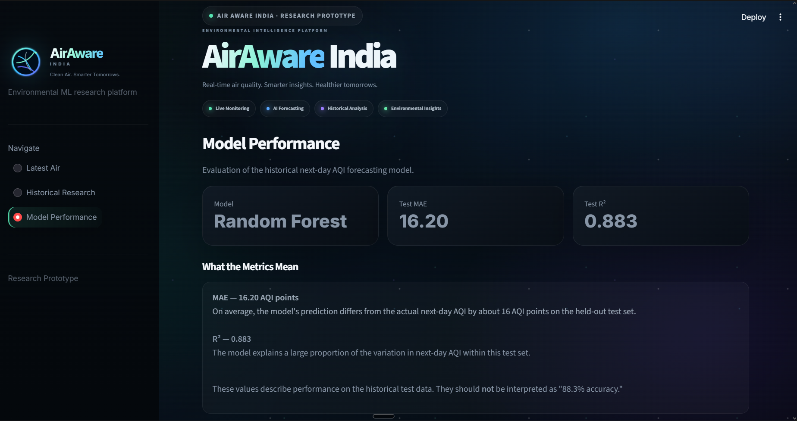

# AirAware India

> **Machine learning for short-term air-quality forecasting and understandable environmental insights.**

AirAware India is a research-oriented environmental ML platform that combines historical Indian air-quality data, short-term AQI forecasting, live monitoring-station data, and a public-facing dashboard.

## Why AirAware?

Air-quality datasets are useful for research, but raw pollutant measurements are difficult for most people to interpret.

AirAware explores whether a lightweight machine-learning model can provide useful **next-day AQI forecasts** while also translating air-quality measurements into simple, understandable environmental information.

## Research Question

> **Can lightweight machine-learning models provide useful next-day AQI forecasts from historical city-level Indian observations, and how well do they generalize to later dates and unseen cities?**

See the [research protocol](docs/RESEARCH_PROTOCOL.md) for the evaluation rules, validation splits, baselines, and limitations.
Dataset provenance and intended-use limitations are documented in the [dataset card](docs/DATA_CARD.md).

## What It Does

- Live monitoring-station discovery across India
- Latest pollutant measurements through OpenAQ
- Optional time-averaged live AQI coverage check with explicit hourly-data requirements
- Estimated CPCB-style AQI calculation
- Next-day AQI forecasting with Random Forest
- Historical city-level air-quality exploration
- Pollutant-level breakdowns
- Forecast evaluation
- Model-performance reporting
- Public-facing environmental insights
- Interactive Streamlit dashboard with animated UI

## System Architecture

```text
Historical Indian AQI Data
        │
        ▼
Data Cleaning
        │
        ▼
Feature Engineering
        │
        ▼
Random Forest Forecasting Model
        │
        ├──────────────► Model Evaluation
        │
        ▼
                 AirAware Dashboard
                        ▲
                        │
                 OpenAQ Monitoring
                        │
                        ▼
                 Latest Pollutants
                        │
                        ▼
              Estimated CPCB-style AQI
                        │
                        ▼
                 Short-term Forecast
                        │
                        ▼
              Environmental Insight
```

## Live Demo

**Public app:** https://airaware-india-s5nokzxaczphwtyzwhscug.streamlit.app/

The Streamlit Community Cloud app was verified in a private/incognito browser session without a sign-in prompt. Live observations and forecasts depend on the availability and freshness of the upstream monitoring data.

## Live-data validity

The main dashboard's current reading and next-day forecast remain an **experimental latest-station-reading workflow**. They are not official CPCB observations, and the historical city-day evaluation is not station-level forecast validation.

The Latest Air page includes an optional **Research check: time-averaged AQI data coverage** panel. When selected, it fetches OpenAQ hourly averages for the chosen station and checks the last 24 hours. PM2.5, PM10, NO2, and SO2 use a rolling 24-hour mean; CO and O3 require a complete consecutive 8-hour window. A pollutant is only accepted when at least 16 distinct hourly observations exist in the 24-hour window, and an overall estimated AQI is only shown when at least three pollutants including PM2.5 or PM10 pass the gate. The panel is additive: it does not alter the existing live reading or forecast.

OpenAQ-derived values and this validation panel are **not official CPCB data**. They are a research estimate based on provider-supplied sensor measurements and supported unit conversions. See [OpenAQ measurement aggregation documentation](https://docs.openaq.org/resources/measurements) and the [CPCB AQI calculation guidance](https://airquality.cpcb.gov.in/ccr_docs/How_AQI_Calculated.pdf). Forecast accuracy at live stations remains unverified until predictions are recorded and compared with later observations from those same stations.

## Prospective station validation

The repository now includes a scheduled, public evidence collector for the live forecast. It records 24-hour predictions and later pairs them with fresh OpenAQ-derived observations from the exact same station ID. Collection requires an OpenAQ API key configured as a GitHub Actions secret; see the [prospective validation protocol](docs/PROSPECTIVE_VALIDATION.md).

The ledger starts empty. A forecast is not an evaluated result until a later eligible same-station observation is collected. The target is an experimental station snapshot, not official CPCB AQI or a regulatory 24-hour average. Historical city-day metrics must not be presented as prospective station performance.

## Dashboard

### Latest Air



### Historical Research



### Model Performance



## Machine Learning

### Target

The main forecasting task predicts:

**Next_Day_AQI**

### Historical model

**Random Forest Regressor**

The final historical model uses:

- City
- PM2.5
- PM10
- NO2
- CO
- SO2
- O3
- Current AQI
- Previous-day AQI
- 3-day AQI average
- AQI change
- Day
- Month
- Day of week

### Reproducible chronological evaluation

GitHub Actions rebuilt the dataset from a checksum-verified raw CSV and retrained the Random Forest using a date-based split and training-only pollutant imputation.

| Metric | Leakage-controlled temporal evaluation |
|---|---:|
| Training rows | 14,232 |
| Held-out test rows | 8,220 |
| Last training feature date | 2019-05-24 |
| First test feature date | 2019-05-26 |
| Test MAE | **16.41 AQI points** |
| Test R² | **0.890** |
| Persistence baseline MAE | **18.81 AQI points** |
| Three-day mean baseline MAE | **22.70 AQI points** |

The model's MAE is about 12.8% lower than the persistence baseline on the same held-out rows. Performance varies across cities; the result is specific to this historical dataset and is not a claim about current air quality.

**Repeated city-group validation adds an uncertainty check.** Across five GroupKFold folds covering all 26 cities, the city-agnostic Random Forest had macro-city MAE 20.133 versus 21.818 for persistence. However, its paired 95% city-bootstrap interval for improvement was **-0.766 to +3.646 AQI points**; the interval includes zero. The city-aware Random Forest interval also includes zero (-2.624 to +3.878). These results do not establish a reliable improvement over persistence on unseen cities. Full fold-level results and methodology are in the [research report](docs/AirAware_Research_Report.md).

**Unseen-city validation is a separate and harder test.** On a deterministic holdout of six cities (4,508 observations), the city-aware Random Forest MAE was 28.25 AQI points, a city-agnostic variant scored 24.64, and persistence scored 22.19. Neither Random Forest beat persistence on this split, so cross-city generalization is not established. See the [research protocol](docs/RESEARCH_PROTOCOL.md).

**Model-family benchmark (fixed splits):** Four candidates were evaluated on identical rows. On the chronological holdout, city-agnostic Random Forest achieved MAE 16.20 (R² 0.895), city-aware Random Forest 16.41 (0.890), city-agnostic Ridge 17.86 (0.869), and city-aware Ridge 18.54 (0.868), versus persistence MAE 18.81. On the six-city holdout, the best candidate was city-agnostic Ridge at MAE 23.49 (R² 0.782), still worse than persistence at 22.19. These results do not justify replacing the deployed Random Forest: the 0.21-point chronological difference is small and no uncertainty interval or repeated split has yet been calculated. The benchmark is exploratory, not a final model-selection claim.

**Why the older model score is not used:** the previous checked-in artifact scored MAE 11.39 and R² 0.938 on a later-date holdout, but its original training cutoff is undocumented. It may have seen future dates during training, so that score is not accepted as reliable out-of-sample evidence.

**Preprocessing method:** pollutant missing values are retained in the prepared dataset and imputed inside the model pipeline using medians fitted only on the training rows. The raw source file is downloaded from a public mirror and verified against SHA-256 `0d84b21c3e4878bbad8df362f2ab05f61ad959538dddf5918e714077ed3c1847` before preprocessing. The source CSV itself is not committed to the repository.

### Separate live forecast model (historical proxy evaluation)

The live dashboard uses a separate compact Random Forest with the six inputs AQI, PM2.5, PM10, day, month, and day of week. It was evaluated using the same chronological date boundary and training-only pollutant imputation, then refit on all eligible historical rows for deployment.

| Metric | Result |
|---|---:|
| Training rows | 14,232 |
| Held-out test rows | 8,220 |
| Test MAE | 16.96 AQI points |
| Test R² | 0.877 |
| Persistence baseline MAE | 18.81 AQI points |
| Three-day mean baseline MAE | 22.70 AQI points |
| Deployment artifact size | 36.4 MiB |

The model reduced MAE by about 9.8% relative to persistence on this historical city-day test. This is a useful proxy evaluation, **not validation of forecasts against future observations from a live monitoring station**. The live UI explicitly labels the forecast as experimental. See the [research report](docs/AirAware_Research_Report.md) for details and limitations.

The baseline is a persistence model:

```text
Tomorrow's AQI = Today's AQI
```

**Important:** R² is not a percentage accuracy score.

### Reproduce the historical evaluation

Install the dependencies:

```bash
pip install -r requirements-dev.txt
```

Run the full reproducible pipeline:

```bash
python src/download_source_data.py
python src/clean_data.py
python src/prepare_ml_data.py
python src/train_model.py
python src/evaluate_baseline.py
python src/evaluate_predictions.py
python src/city_evaluation.py
python src/feature_importance.py
```

To evaluate an existing compatible model artifact against the prepared dataset, run `python src/evaluate_saved_model.py` before retraining. The downloader verifies the source CSV checksum and fails closed if the file differs. The training pipeline learns pollutant imputation values only from training-period rows; the held-out test period is not used to fit the imputer.

## Expanding-window rolling-origin evaluation

A five-fold expanding-window evaluation was added to test whether temporal performance remains stable across successive future periods. It produced 16,577 out-of-fold rows, with training-only preprocessing and a one-day target gap at each fold boundary.

| Model | Pooled MAE | Pooled RMSE |
|---|---:|---:|
| Persistence | 22.1571 | 35.8745 |
| Three-day mean | 26.3910 | 40.9693 |
| Random Forest (city-aware) | **19.3747** | **29.9239** |
| Random Forest (city-agnostic) | 19.5583 | 30.1022 |
| Ridge (city-agnostic) | 21.1455 | 32.0839 |

The city-aware Random Forest reduced pooled MAE by 12.6% versus persistence on these rolling-origin test rows. It did not beat persistence in every fold. This is temporal evaluation for cities represented in the historical dataset—not unseen-city generalisation, station-level prospective validation, or official CPCB AQI accuracy. The fixed unseen-city holdout still shows that the tested models do not beat persistence. See the [research report](docs/AirAware_Research_Report.md) and [research protocol](docs/RESEARCH_PROTOCOL.md) for full details.

## Feature Importance

The leakage-controlled training run identified current AQI as the dominant predictor (importance 0.8034), followed by PM2.5 (0.0753). Feature importance is descriptive, not causal.

This is consistent with the short-horizon nature of the forecasting problem: today's air-quality state contains substantial information about the following day's conditions.

## Live Monitoring

AirAware uses **OpenAQ** to discover Indian monitoring stations and retrieve recent pollutant observations.

The live pipeline:

```text
OpenAQ
  ↓
Indian monitoring stations
  ↓
Selected station
  ↓
Latest pollutant observations
  ↓
Unit normalization
  ↓
Estimated pollutant sub-indices
  ↓
Estimated CPCB-style AQI
  ↓
AirAware forecast
```

### Important live-data limitation

The live value displayed by AirAware is an **estimated CPCB-style AQI**, not an official CPCB AQI.

Official AQI calculations use prescribed averaging periods and sufficient observations. A latest station measurement may not satisfy those requirements.

The dashboard therefore clearly treats this component as a research prototype.

## Historical Data

The historical model was developed using Indian city-level air-quality observations from **2015–2020**.

**Data provenance:** The raw dataset is the Air Quality Data in India city-day dataset, originally distributed on [Kaggle](https://www.kaggle.com/datasets/rohanrao/air-quality-data-in-india). The project downloads a pinned [GitHub mirror](https://github.com/govindlabhala-cell/India-Air-Quality-EDA) and verifies its SHA-256 checksum before processing. The [TUMI data portal](https://portal.transport-data.org/@tumi/urban-air-pollution-india-2015-2020) lists the dataset under CC0 1.0. The mirror is used for reproducibility and is not claimed as the original publisher.

The data-processing pipeline includes:

1. Removing invalid dates and unusable AQI records
2. Retaining missing pollutant observations for train-only imputation
3. Normalizing pollutant columns
4. Creating chronological city-level features
5. Creating previous-day AQI
6. Creating a rolling 3-day AQI average only when all three calendar days are consecutive
7. Creating AQI change
8. Creating calendar features
9. Creating a true next-day prediction target

## Project Structure

```text
AirAware-India/
├── app.py
├── README.md
├── requirements.txt
├── requirements-dev.txt
├── .env.example
├── data/
│   ├── cleaned_city_day.csv
│   └── ml_data.csv
├── docs/
│   ├── DATA_CARD.md
│   ├── RESEARCH_PROTOCOL.md
│   ├── AirAware_Research_Report.md
│   └── screenshots/
├── models/
│   ├── airaware_random_forest_v3.joblib
│   └── airaware_live_rf.joblib
├── reports/
│   ├── actual_vs_predicted.png
│   ├── aqi_distribution.png
│   ├── average_aqi_by_city.png
│   └── pm25_vs_aqi.png
├── src/
│   ├── download_source_data.py
│   ├── clean_data.py
│   ├── prepare_ml_data.py
│   ├── train_model.py
│   ├── train_live_model.py
│   ├── evaluate_baseline.py
│   ├── evaluate_city_holdout.py
│   ├── evaluate_predictions.py
│   ├── city_evaluation.py
│   ├── evaluation_utils.py
│   ├── live_air.py
│   ├── live_forecast.py
│   └── live_forecast_features.py
└── tests/
    ├── test_evaluation_utils.py
    ├── test_data_preparation.py
    ├── test_city_holdout.py
    ├── test_live_air_units.py
    ├── test_live_forecast_features.py
    └── test_live_model_training.py
```

## Tech Stack

**Machine Learning**
- Python
- Pandas
- NumPy
- Scikit-learn
- Joblib

**Data**
- Historical Indian air-quality data
- OpenAQ API

**Application**
- Streamlit
- HTML/CSS
- JavaScript
- Three.js
- GSAP

## Run Locally

### 1. Clone

```bash
git clone https://github.com/aaravpachouri/AirAware-India.git
cd AirAware-India
```

### 2. Create a virtual environment

Windows:

```powershell
python -m venv .venv
.venv\Scripts\activate
```

### 3. Install dependencies

```powershell
pip install -r requirements.txt
```

### 4. Configure OpenAQ

```powershell
copy .env.example .env
```

Add your own key:

```env
OPENAQ_API_KEY=your_openaq_api_key
```

Never commit `.env`.

### 5. Run the application

```powershell
streamlit run app.py
```

## Research Pages

### Latest Air

Shows:

- Selected monitoring station
- Latest pollutant measurements
- Estimated AQI
- AQI category
- Tomorrow's predicted AQI
- AQI movement
- Pollutant sub-indices
- Environmental guidance

### Historical Research

Allows exploration of:

- Historical city/date observations
- Current AQI
- Predicted next-day AQI
- Actual next-day AQI where available
- Prediction error
- Recent AQI trend

### Model Performance

Documents:

- Model type
- MAE
- R²
- Feature set
- Research limitations

## Reports

The `reports/` directory contains the main research visualizations:

- AQI distribution
- Average AQI by city
- PM2.5 vs AQI
- Actual vs predicted AQI

## Limitations

AirAware is intentionally presented as an experimental research prototype.

Current limitations include:

- Historical training data is city-level
- Live monitoring data can be delayed
- Live point measurements do not necessarily satisfy official AQI averaging requirements
- The historical model is optimized for short-term forecasting rather than long-range prediction
- Performance varies by city
- A strong persistence baseline means short-term AQI prediction is inherently challenging

## Future Research

Potential extensions include:

- Longer prospective same-station validation with a pre-defined sample-size target
- Additional meteorological features
- Stronger baseline comparisons
- Probabilistic forecasting
- Multi-step forecasting
- Better handling of missing observations
- Station-specific modelling
- Broader public-health communication research

## Portfolio Context

AirAware India is part of a broader progression of AI/ML projects:

```text
JARVIS X
Software Engineering + AI Agents
        ↓
RAG Model
Retrieval + NLP + Multimodal AI
        ↓
AirAware India
Machine Learning + Forecasting + Environmental Impact
        ↓
Future Flagship AI Model
Model Training + Evaluation + Open Research
```

## Status

**Current status: Public research prototype**

The project is deployed as an interactive Streamlit application and maintained as an open-source research/engineering project.

## License

No repository license is currently declared. Public visibility does not itself grant permission to reuse or redistribute the source; add a license only after choosing the intended terms.

---

**Built by Aarav Pachouri**
